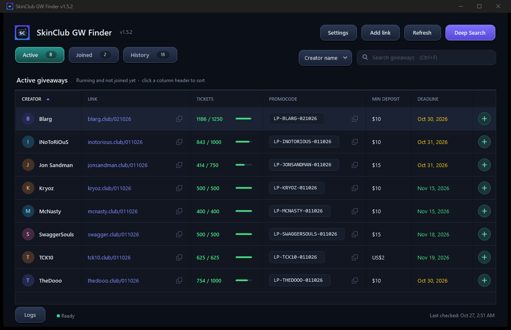

# SkinClub GW Finder

A Windows desktop app that finds SkinClub creator giveaways, checks each one, and keeps them organised so you can see at a glance what is running, what you joined, and what has ended.

## Features

### Finding giveaways
- **Deep Search** looks through Telegram, YouTube, web search and about 50 known creator sites, and checks the dated giveaway pages each creator usually posts (the 1st and 2nd of recent months and next month).
- **Learns new creators:** once one link from a creator is saved, that creator's later giveaways are found automatically.
- **Automatic search:** a Deep Search runs by itself every 60 minutes and the saved giveaways are re-checked every 10 minutes. Starting the app only does the quick re-check.
- **Runs in the tray:** closing the window keeps the app running in the system tray, still checking for giveaways. Right-click the tray icon for Deep Search, Refresh, Joined giveaways or Exit; left-click opens the window.
- **Notifications:** an optional Windows notification when a new giveaway appears or one ends today.

### Reading each giveaway
- **Works in any language:** English, Spanish, Portuguese, Turkish, Arabic and others.
- **Shows what matters:** the total prize pool, tickets left out of the total, the entry promocode, the minimum deposit (always in USD, for example `5$`) and the deadline with how many days are left.
- **Every page is checked** before it is added, and pages that do not answer are tried again instead of being skipped.

### Keeping them organised
- **Creator, Joined and History tabs.** Creator lists the running creator giveaways. Press **+** to move one to Joined; press **×** there to send it back.
- **Quizzes tab:** every SkinClub community quiz with its link, 1st-place prize, number of participants and end date, live quizzes first.
- **History** keeps ended giveaways, newest first, with their promocode and deposit.
- **Stats strip:** active giveaways and tickets left, giveaways ending within 48 hours, joined giveaways, and the cheapest entry.
- **Sort** any column (prize pools and deposits by amount) and **search** by creator, link, prize pool, tickets, promocode, deposit or deadline (Ctrl+F).
- **One click** opens a giveaway or copies its link or promocode.

### Everyday use
- **Refresh** re-checks tickets, deadlines and ended status of your saved giveaways in a few seconds.
- **Add links:** paste one or many giveaway links at once, one per line.
- **Logs** show what the app is doing during a search.
- **Settings** for the check intervals, History size, notifications and History display.
- **Your data stays on your PC** and carries over between versions.

## Install

Download the latest Windows ZIP from [Releases](https://github.com/Smokianlord/SkinClub-GW-Finder/releases), extract it, close any older copy, and run `SkinClubGWFinder.exe`. No installer is needed.

Requires Windows 10 or 11 with .NET Framework 4.8 (included with Windows). Microsoft Edge, which comes with Windows, is used in the background for the few pages that need it.

Saved giveaways are kept in `%LOCALAPPDATA%\SkinClub GW Finder\`.

## Building from source

Run `BUILD_EXE.bat` to compile and start the app, or `scripts/build.ps1` to compile only. `scripts/package-release.ps1` creates the release files in `dist/`.

Tests: `tests/run.ps1` (interface and saved data) and `tests/run-browser.ps1` (background browser handling).
